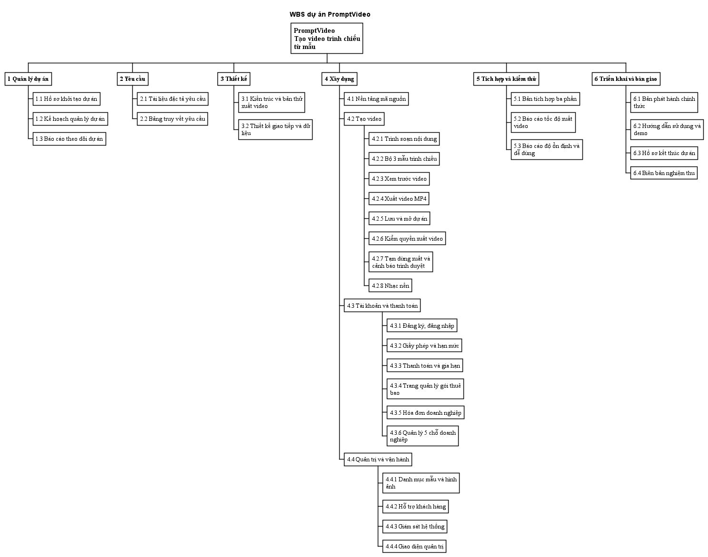

# WBS dự án PromptVideo

**Phiên bản:** 2.0  
**Ngày:** 14/10/2026  
**Trạng thái:** Bản nháp, chưa duyệt  
**Người soạn:** Nguyễn Thế Chiến  
**Người kiểm:** Nguyễn Việt Quang

Bản chính nằm trên Google Drive, thư mục 02_Planning, tài liệu "05_WBS_v2.0". File này là bản sao trên máy.

## 1. Mục đích

WBS (bảng chia nhỏ công việc) chia toàn bộ việc của dự án PromptVideo thành các gói công việc. Mỗi gói là một sản phẩm giao được, có một người phụ trách và có điều kiện rõ để tính là xong.

Cây có 6 nhánh theo giai đoạn. Riêng nhánh Xây dựng được chia theo ba phần của sản phẩm: Tạo video, Tài khoản và thanh toán, Quản trị và vận hành. Tổng cộng có 32 gói công việc.

## 2. Cây WBS

- PromptVideo – Trình tạo video trình chiếu
  - 1 Quản lý dự án
    - 1.1 Hồ sơ khởi tạo dự án
    - 1.2 Kế hoạch quản lý dự án
    - 1.3 Báo cáo theo dõi dự án
  - 2 Yêu cầu
    - 2.1 Tài liệu đặc tả yêu cầu
    - 2.2 Bảng truy vết yêu cầu
  - 3 Thiết kế
    - 3.1 Kiến trúc và bản thử xuất video
    - 3.2 Thiết kế giao tiếp và dữ liệu
  - 4 Xây dựng
    - 4.1 Nền tảng mã nguồn
    - 4.2 Tạo video
      - 4.2.1 Trình soạn nội dung
      - 4.2.2 Bộ 5 mẫu trình chiếu
      - 4.2.3 Xem trước video
      - 4.2.4 Xuất video MP4
      - 4.2.5 Lưu và mở dự án
      - 4.2.6 Kiểm quyền xuất video
      - 4.2.7 Tạm dừng xuất và cảnh báo trình duyệt *
    - 4.3 Tài khoản và thanh toán
      - 4.3.1 Đăng ký, đăng nhập
      - 4.3.2 Giấy phép và hạn mức
      - 4.3.3 Thanh toán và gia hạn
      - 4.3.4 Trang quản lý gói thuê bao
      - 4.3.5 Hóa đơn doanh nghiệp *
      - 4.3.6 Quản lý 5 chỗ doanh nghiệp *
    - 4.4 Quản trị và vận hành
      - 4.4.1 Danh mục mẫu và hình ảnh
      - 4.4.2 Hỗ trợ khách hàng *
      - 4.4.3 Giám sát hệ thống
      - 4.4.4 Giao diện quản trị *
  - 5 Tích hợp và kiểm thử
    - 5.1 Bản tích hợp ba phần
    - 5.2 Báo cáo tốc độ xuất video *
    - 5.3 Báo cáo độ ổn định và dễ dùng *
  - 6 Triển khai và bàn giao
    - 6.1 Bản phát hành chính thức *
    - 6.2 Hướng dẫn sử dụng và demo
    - 6.3 Hồ sơ kết thúc dự án
    - 6.4 Biên bản nghiệm thu *

Gói có dấu * là gói chưa chia thành việc cụ thể.

## 3. Các gói công việc

| Mã | Gói công việc | Phụ trách | Giờ | Tính là xong khi |
| --- | --- | --- | --: | --- |
| **1** | **Quản lý dự án** | | **67** | |
| 1.1 | Hồ sơ khởi tạo dự án | Chiến | 23 | Business Case, kế hoạch lợi ích, Charter, sổ giả định và danh sách bên liên quan khớp nhau về tên, mục tiêu, ngân sách; Nhà tài trợ ký duyệt. |
| 1.2 | Kế hoạch quản lý dự án | Chiến | 28 | Kế hoạch chung và các kế hoạch con khớp nhau về phạm vi, lịch, chi phí; được duyệt. |
| 1.3 | Báo cáo theo dõi dự án | Việt Quang | 16 | Báo cáo hằng tuần có ngày, tình trạng và bằng chứng; giờ làm thực tế được ghi đủ. |
| **2** | **Yêu cầu** | | **20** | |
| 2.1 | Tài liệu đặc tả yêu cầu | Chiến | 12 | Mỗi yêu cầu đo được, có ca kiểm thử và truy được về Charter. |
| 2.2 | Bảng truy vết yêu cầu | Chiến | 8 | Mọi yêu cầu được nối với mục tiêu dự án và ca kiểm thử. |
| **3** | **Thiết kế** | | **33,3** | |
| 3.1 | Kiến trúc và bản thử xuất video | Chiến | 10 | Bản thử xuất được file MP4, có ghi cấu hình máy và kết quả đo. |
| 3.2 | Thiết kế giao tiếp và dữ liệu | Chiến | 23,3 | Mỗi giao tiếp giữa ba phần có dữ liệu gửi, nhận, lỗi và phiên bản; dự án lưu rồi mở lại không mất dữ liệu. |
| **4** | **Xây dựng** | | **363,7** | |
| 4.1 | Nền tảng mã nguồn | Việt Quang | 24 | Từ bản sao mới của kho mã, build và chạy kiểm thử tự động được; không lộ mật khẩu hay khóa bí mật. |
| **4.2** | **Tạo video** | | **139** | |
| 4.2.1 | Trình soạn nội dung | Chiến | 28,7 | Soạn chữ, ảnh, hoàn tác, làm lại và phím tắt chạy đúng các ca kiểm thử. |
| 4.2.2 | Bộ 5 mẫu trình chiếu | Chiến | 13,3 | Đủ 5 mẫu; đổi mẫu không mất nội dung. |
| 4.2.3 | Xem trước video | Chiến | 24,7 | Hình xem trước khớp với video xuất ra. |
| 4.2.4 | Xuất video MP4 | Chiến | 22 | File MP4 phát được; có thanh tiến trình và nút hủy; chỉ xuất khi có quyền. |
| 4.2.5 | Lưu và mở dự án | Chiến | 15,3 | Lưu, mở, khôi phục dự án trên máy người dùng không mất dữ liệu. |
| 4.2.6 | Kiểm quyền xuất video | Chiến | 23,7 | Chỉ xuất khi máy chủ xác nhận còn lượt; chỉ dùng mẫu đang được phép dùng. |
| 4.2.7 | Tạm dừng xuất và cảnh báo trình duyệt * | Chiến | 11,3 | Tạm dừng và tiếp tục xuất được; báo cho người dùng khi trình duyệt không hỗ trợ. |
| **4.3** | **Tài khoản và thanh toán** | | **128,7** | |
| 4.3.1 | Đăng ký, đăng nhập | Việt Quang | 14 | Đăng ký, đăng nhập, đổi mật khẩu, khóa tạm khi nhập sai nhiều lần chạy đúng. |
| 4.3.2 | Giấy phép và hạn mức | Việt Quang | 24 | Trừ lượt khi bắt đầu xuất; xuất xong thì giữ; hủy thì hoàn lại đúng một lần. |
| 4.3.3 | Thanh toán và gia hạn | Việt Quang | 26,7 | Mua và gia hạn gói không bị trừ tiền hai lần; có nhắc gia hạn; bản chạy thật không dùng cổng thanh toán giả. |
| 4.3.4 | Trang quản lý gói thuê bao | Việt Quang | 16 | Trang hiện đúng gói, lượt còn lại, hạn dùng, lịch sử mua, hóa đơn và chỗ dùng. |
| 4.3.5 | Hóa đơn doanh nghiệp * | Việt Quang | 22 | Mỗi lần mua gói Doanh nghiệp thành công có đúng một hóa đơn; cách tính thuế được kiểm lại. |
| 4.3.6 | Quản lý 5 chỗ doanh nghiệp * | Việt Quang | 26 | Gói Doanh nghiệp có tối đa 5 chỗ, tính cả chủ gói; cấp và thu hồi chỗ đúng quyền. |
| **4.4** | **Quản trị và vận hành** | | **72** | |
| 4.4.1 | Danh mục mẫu và hình ảnh | Quang Anh | 22 | Quản trị viên thêm, sửa, ngừng dùng mẫu; mẫu được kiểm lỗi trước khi phát hành. |
| 4.4.2 | Hỗ trợ khách hàng * | Quang Anh | 20 | Tra cứu được tài khoản, nhận yêu cầu hỗ trợ, bù lượt có ghi lý do và lưu lại lịch sử. |
| 4.4.3 | Giám sát hệ thống | Quang Anh | 14 | Có số liệu theo dõi máy chủ và số liệu để đo lợi ích; thiếu số nào thì ghi rõ. |
| 4.4.4 | Giao diện quản trị * | Quang Anh | 16 | Có màn hình quản lý mẫu, yêu cầu hỗ trợ và số liệu; người dùng thường không vào được. |
| **5** | **Tích hợp và kiểm thử** | | **65** | |
| 5.1 | Bản tích hợp ba phần | Chiến | 16,3 | Ba phần chạy cùng nhau trên máy chủ thật; mỗi kết quả ghi rõ bản build, môi trường và file bằng chứng. |
| 5.2 | Báo cáo tốc độ xuất video * | Chiến | 28 | Video 1080p xuất xong trong không quá 1,5 lần độ dài video; kết quả giống nhau trên 3 máy. |
| 5.3 | Báo cáo độ ổn định và dễ dùng * | Chiến | 20,7 | Kiểm đủ các trường hợp chữ tiếng Việt, 100 lần xuất và 10 người dùng thử, đạt mục tiêu trong Charter. |
| **6** | **Triển khai và bàn giao** | | **50** | |
| 6.1 | Bản phát hành chính thức * | Quang Anh | 20 | Chạy trên máy chủ thật có HTTPS; sao lưu và khôi phục được. |
| 6.2 | Hướng dẫn sử dụng và demo | Quang Anh | 10 | Người ngoài nhóm làm theo hướng dẫn chạy lại được bản demo. |
| 6.3 | Hồ sơ kết thúc dự án | Quang Anh | 12 | Báo cáo cuối, biên bản bàn giao, bài học kinh nghiệm và bài trình bày đủ và khớp số liệu. |
| 6.4 | Biên bản nghiệm thu * | Chiến | 8 | Kết quả kiểm thử đạt; người có thẩm quyền ký nhận sản phẩm. |
| | **Tổng cộng** | | **599** | |

## 4. Ghi chú

Số giờ của mỗi gói là trung bình của ba con số: làm nhanh nhất, bình thường và chậm nhất. Tổng là 599 giờ, quy ra công là 47.920.000 đồng (80.000 đồng/giờ). Đây là công của thành viên, không phải tiền chi ra.

Tổng 599 giờ vượt mức trần 495 giờ trong Charter. Nhóm đã lập đề nghị thay đổi (giữ phạm vi, điều chỉnh lịch và nguồn lực) và đang chờ Nhà tài trợ quyết định.

9 gói có dấu * chưa được chia thành việc cụ thể. Người phụ trách sẽ chia nhỏ trước khi bắt đầu làm gói đó.

Sau khi được duyệt, WBS cùng Tuyên bố phạm vi trở thành mốc chuẩn phạm vi. Muốn thêm, bớt hay đổi gói phải qua quy trình kiểm soát thay đổi.
